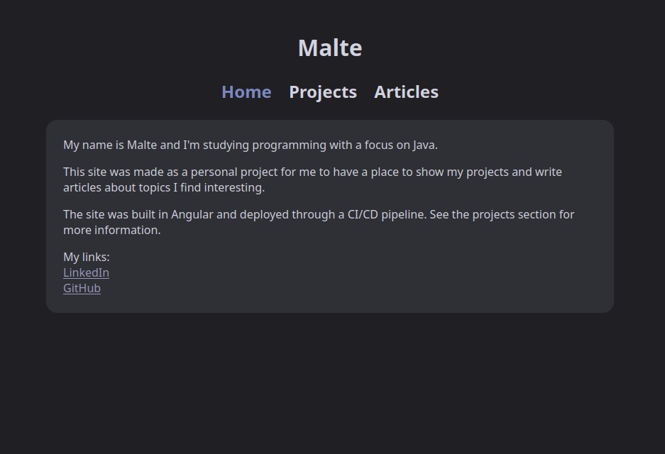
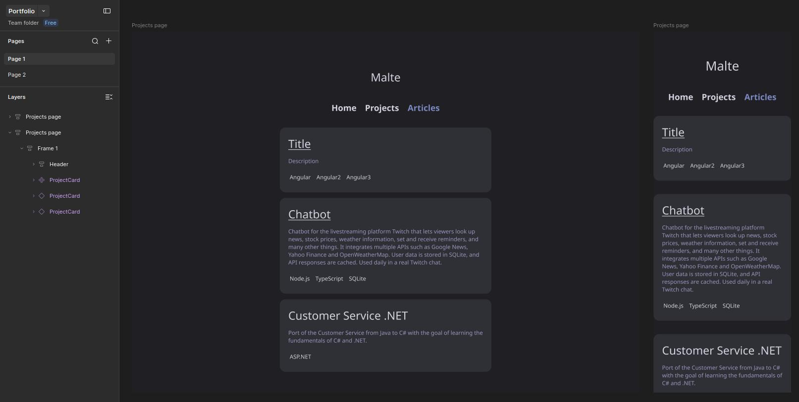

# Portfolio

My personal portfolio website where I show some of my projects and write articles.

**Live site:** https://malte0v0.github.io

## Why I built it

I built this site to learn Angular and to practise UI design in Figma. It's an ongoing project, and I add features as I learn new things.

## Features

- Project list with details about each project
- Articles with their own pages
- Markdown rendering for project and article pages
- Tests and deploys to GitHub pages automatically on every push to `main`

## CI/CD

- **CI** (`.github/workflows/ci.yml`): runs on every pull request to `main` or `develop`.
- **CD** (`.github/workflows/cd.yml`): runs on every push to `main`. Runs the tests, builds the site and deploys it to GitHub Pages.

## Planned

- [ ] Change browser tab title
- [ ] Create a custom favicon
- [ ] Add meta description
- [ ] Add tags
- [ ] Add on hover animations
- [ ] Add a footer
- [ ] Use my own domain